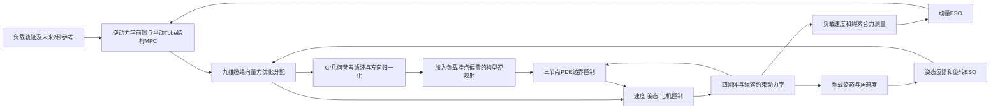

# 合力前馈预测与集群编队逆向映射实现说明

本次在申请书第 2.3(1) 节 PDE 编队控制的基础上，接入第 2.3(3) 节式 (17)—(29) 的控制链：负载逆动力学、动量扰动观测、平动管束模型预测、缆绳向量力优化分配、构型逆映射及 PDE 跟踪。输出来自相同的三机刚性吊载物理模型，本次不开展算法性能对照。运行结果见 [合力预测与逆映射仿真报告](../results/合力预测与逆映射仿真报告.md)。

这里的 Tube 设计对象是三维平动的线性双积分器。转动由旋转 ESO 和姿态反馈处理，不把它表述为全六自由度非线性 Tube MPC。原申请书未明确的离散模型、扰动界、终端条件、力可行域和接口由本工程补全，并在下文说明理论与数值结果的边界。

## 1 申请书对应关系

| 申请书位置 | 原文方法 | 当前代码 |
| --- | --- | --- |
| 2.3(3)a，式 (17)—(18) | 轨迹逆动力学合力/力矩前馈 | `force_controller.py`，世界 z 轴向上，参考姿态为水平固定姿态 |
| 式 (19)—(21) | 动量误差和扩张状态观测 | `force_mapping.py` 的 `MomentumESO`，平动与转动各一个 |
| 2.3(3)b，式 (22)—(26) | 名义预测、局部反馈、变化率惩罚、管束收紧 | `tube_mpc.py`，20 步、0.1 秒采样的平动模型 |
| 2.3(3)c，式 (27)—(28) | 合力和力矩约束下的缆绳力分配 | `CableAllocator`，9 个力向量分量、6 条平衡等式和正拉力锥 |
| 式 (29) | 力方向到编队位置的逆映射 | `inverse_geometry`，包含负载挂点偏置以及解析速度/加速度 |
| 2.3(1)，式 (1)、(6)—(9) | PDE 编队与反步边界控制 | 保留 `pde.py`，向其输入变化的构型参考 |

本版继续采用第 2.3(1) 节的一阶 PDE 边界控制，不再叠加第 2.3(3) 节式 (30)—(31) 的另一套二阶人工势场编队控制，以免同一层的控制指令相互覆盖。

## 2 测量与扰动观测

研究仿真中假设能取得无噪声负载位置、姿态、速度、角速度，以及三根绳的拉力和方向；由绳力测量求出实际合力和力矩。它们对应理想模拟位姿/速度测量与拉力传感器，尚未由用户的雷达和实机硬件实现。

输入观测器的是实际绳索合力，不是理想分配值：

\[
F_{\rm meas}=\sum_iT_iq_i,\qquad
M_{\rm meas}=\sum_i(R_Lr_i)\times T_iq_i.
\]

在世界 z 轴向上的坐标下，平动模型为

\[
\dot v_L=F_{\rm meas}/m_0-ge_3+d_F/m_0.
\]

LESO 的实现是

\[
\dot{\hat v}=F_{\rm meas}/m_0-ge_3+\hat d_F/m_0+2\omega_o(v_L-\hat v),
\qquad \dot{\hat d}_F=m_0\omega_o^2(v_L-\hat v).
\]

使用相邻两次测量的线性插值进行 RK4 更新，带宽 ωₒ=3 rad/s。它与原文在速度误差坐标中构造的观测器相容；本版直接估计速度以简化接口，扰动输出的单位是 N。

旋转观测器在负载体坐标中采用同一结构，以对角惯量代替质量，已知角加速度项是 `I⁻¹[M_meas,body−ω×Iω]`，输出的单位是 N·m。

注入风力、阻尼真值和真实加速度只进入事后评价日志，不传入控制器。图中的扰动真值用于核对 ESO 估计。当前同质量、无噪声工况不能证明对任意载重失配或真实传感误差均有效。

## 3 合力前馈与滚动预测

轨迹前馈与 ESO 补偿分别为

\[
F_{\rm base}=m_0(\ddot p_{L,d}+ge_3),\qquad
F_{\rm ESO}=F_{\rm base}-\hat d_F.
\]

平动预测以净加速度为优化变量，对每个世界轴使用

\[
x_{k+1}=Ax_k+Bu_k+w_k,\quad
A=\begin{bmatrix}1&h\\0&1\end{bmatrix},\quad
B=\begin{bmatrix}h^2/2\\h\end{bmatrix},\quad h=0.1~s.
\]

名义状态 z 满足 `z⁺=Az+Bū`；第一次求解时设为测量状态，此后持续传播，不在每次求解时重置到实际状态。实际指令是

\[
u=\bar u_0+K(x-z),\qquad K=[-1,-2],\qquad
F_{\rm req}=m_0(u+ge_3)-\hat d_F.
\]

控制时刻之间用上一段名义加速度解析传播名义位置/速度，每 0.02 秒更新局部反馈和合力需求。预测器每 0.1 秒求解 20 步的 QP，并使用未来 2 秒真实任务参考；它不是只对当前加速度进行低通滤波。

每轴目标函数是

\[
\sum_{j=1}^{N}\|z_j-x_{d,j}\|_{Q_j}^2
+R\sum_{j=0}^{N-1}(\bar u_j-\ddot p_{d,j})^2
+S\sum_{j=0}^{N-1}(\bar u_j-\bar u_{j-1})^2.
\]

取 Q=diag(20,8)、R=0.5、S=8；末步使用 DARE 终端代价，首个差分项引用上一周期名义输入。加速度变量与原文力变量通过质量缩放相联系，变化率惩罚主动约束合力变化。独立各轴模型和边界使三个 QP 可以分别求解。

参考姿态本次固定为单位矩阵，式 (18) 的角运动前馈为零。力矩需求由小角度范围下的几何姿态误差反馈、角速度阻尼、陀螺项补偿和旋转 ESO 组成：

\[
M_{\rm req}=R_L[-k_Re_R-k_\omega\omega+\omega\times I\omega-\hat d_M].
\]

本版取 k_R=0.03、k_ω=0.008，使外层力矩反馈弱于内部姿态和绳索模态；尚未实现未来角运动轨迹的预测优化。

## 4 管束与约束收紧的实际计算

设 `A_c=A+BK`。解离散 Lyapunov 方程

\[
A_c^TPA_c-P=-I,
\]

并计算 P 范数收缩率 `γ=‖A_c‖_P<1`。每轴假设残余加速度的绝对值不超过 ā，则一步扰动集取保守矩形

\[
W=\{w: |w_p|\le h^2\bar a/2,\ |w_v|\le h\bar a\}.
\]

取 `d=max_{w∈W}‖w‖_P`，`ρ=d/(1−γ)`，得到误差管束

\[
Z=\{e:e^TPe\le\rho^2\}.
\]

由 `‖A_ce+w‖_P≤γρ+d=ρ`，该集合对上述线性误差模型和 W 正不变。矩形角点用于计算 d，三个轴的椭圆笛卡尔积组成六维管束。

程序按支持函数计算收紧量：

\[
\Delta x_j=\rho\sqrt{(P^{-1})_{jj}},\qquad
\Delta u=\rho\sqrt{KP^{-1}K^T}.
\]

因此名义约束是 `z∈X⊖Z`、`ū∈U⊖KZ`。原文式 (25) 的输入收紧写为 `KW`，本版采用误差管束像 `KZ`，因为局部反馈作用于状态偏差，而非直接作用于一步扰动。

本次设计残余加速度界为 `[0.35,0.35,0.03] m/s²`；由此得到水平位置收紧约 0.815 m、水平速度收紧约 1.429 m/s、水平输入收紧约 2.528 m/s²。它们来自保守集合计算，不是为了展示效果任意画出的曲线。

**解释范围：**没有设计终端不变约束集，也没有证明分配平滑、PDE、四旋翼执行环的非线性误差始终属于 W。因此不宣称完整非线性系统的递归可行性或全局鲁棒稳定性。仿真逐样本检查管束利用率和实际加速度残差，结果仅支持本次工况。预测输入/状态约束属于负载质心线性模型，不能替代完整吊运系统的碰撞约束。

## 5 向量力分配

三根方向固定的绳只有三个标量张力自由度，不能普遍解出任意六维需求。为同时反算构型，本版把三根期望绳力 `f_i∈R³` 作为未知量，组成九维 f，并构造

\[
G=\begin{bmatrix}I&I&I\\[r_1]_\times&[r_2]_\times&[r_3]_\times\end{bmatrix},
\qquad Gf=\begin{bmatrix}F_{\rm req}\\M_{\rm req}\end{bmatrix}.
\]

G 使用期望负载姿态 R_d=I 下的三个真实挂点力臂，本例秩为 6。当前物理负载姿态可以偏离期望，因此实际力矩另行从真实状态计算，不由 G 的分配值替代。

优化目标取

\[
\min_f\sum_i\|f_i-f_{i,spread}\|^2
+\eta\sum_i\|f_i-f_{i,prev}\|^2,
\]

\[
f_{i,spread}=F_{\rm req}/3+
\frac{F_{{\rm req},z}}3\tan(20^\circ)e_{r,i},\qquad\eta=1.
\]

这是对原文最小拉力平方目标的工程补充：单纯最小力范数会趋向三根绳竖直，使三机逼近间隔很小的负载挂点。名义内拉力项维持展开构型；变化惩罚作用于分配自由度。实际机间距仍需由物理状态检查，不能据此宣称任意工况均无碰撞。

每根绳的线性可行域使用保守力锥：

\[
4\le f_{i,z}\le18\cos35^\circ,\qquad
|f_{i,x}|+|f_{i,y}|\le\tan35^\circ f_{i,z}.
\]

这组凸约束保证绳力为向上的正拉力，且 `4≤‖f_i‖≤18 N`、倾角不超过 35°。它不是所有可行力方向的完整刻画。QP 必须报告 `solved` 且通过显式等式/不等式残差检查，否则仿真报告失败；不静默接受不可行解或把负张力截为零。

## 6 平滑力序列和逆向映射

QP 的离散输出经过因果三阶临界阻尼滤波：

\[
(D+\omega_f)^3f_{i,s}=\omega_f^3f_{i,QP},\qquad\omega_f=3~rad/s.
\]

采用上一保持输入下的精确离散更新，再设置当前 QP 解作为下一段输入，避免使用未来信息。滤波器具有非负脉冲响应，初态与初始输入一致且初始导数为零时，保持固定凸力锥；其力、力的一阶和二阶导数连续。

滤波会使平滑合力与当前需求存在动态差异。日志分别保存原始 QP 等式残差、滤波后的合力，以及物理实际合力；不能用原始分配的近零残差宣称平滑后或实物合力完全相等。

由向量力反算方向和编队位置：

\[
q_{i,d}=f_{i,s}/\|f_{i,s}\|,\qquad
p_{i,d}=p_{L,d}+R_{L,d}r_i+l_iq_{i,d}.
\]

这里补回了原文式 (29) 简写中缺少的 `R_d r_i`，与前文式 (2) 的非零挂点几何一致。将标量张力归一化无法给出空间方向，必须归一化分配得到的三维向量。

令 `T=‖f‖`、`Ṫ=qᵀḟ`，解析导数为

\[
\dot q=(\dot f-q\dot T)/T,\qquad
\ddot T=\dot q^T\dot f+q^T\ddot f,\qquad
\ddot q=(\ddot f-q\ddot T-2\dot q\dot T)/T.
\]

因参考姿态固定，`v_i,d=v_L,d+l_i q̇_i,d`、`a_i,d=a_L,d+l_i q̈_i,d`。每架机有各自的参考导数，导出的 CSV 不再把统一负载速度误填为各机速度。

## 7 PDE 与物理闭环

PDE 层现在使用 `e_i=p_i−p_i,d`、`ė_i=v_i−v_i,d`，目标是跟随逆映射生成的动态构型。锚点、跟随者和领导者的边界核、空间差分与动态边界实现保持原方法。

无人机合推力前馈改为

\[
F_{i,d}=m_i(a_{i,c}+ge_3)+f_{i,QP},
\]

其中 `a_i,c` 来自 PDE 速度跟随。当前 QP 绳力直接进入执行器力前馈，几何参考采用 C² 滤波后的力方向；这样保留及时的力矩阻尼，避免把阻尼反馈也延迟到慢参考通道。优化绳力既改变编队参考，也进入推力需求。两条通道的差异和实际响应分别记录，真实绳张力仍由独立物理约束求解。

## 8 当前运行与范围

默认 `configs/force_pde.json`，104 秒 S 形往返，3 kg 负载和假设 2.5 kg 单机。此次从名义悬停开始，在 t=20—28 s 向负载施加峰值 0.3 N 的平滑 y 向力 `0.3 sin²[π(t−20)/8]`，让扰动估计和前馈修正有明确的观测对象；没有算法性能对照。

这不是雷达误差或真实风场模型。ESO/控制所需负载状态和拉力测量尚未由实机提供，全部参数也尚未实测辨识。用户计划的实机轨迹复现可使用后续校核后的逆映射参考，但不能由回放图片证明 ESO、Tube MPC 或 PDE 已在线运行。

主要文件：`force_controller.py` 串联控制链，`tube_mpc.py` 实现预测与管束，`force_mapping.py` 实现 ESO/分配/平滑/逆映射，`force_results.py` 与 `force_visualization.py` 从保存的数据计算指标和绘图。

## 9 资料

原始依据为用户申请书第 2.3(3) 节及当前工作区的段落提取记录。QP 接口和求解状态按 [OSQP 官方 Python 文档](https://osqp.org/docs/interfaces/python.html) 与 [状态码说明](https://osqp.org/docs/interfaces/status_values.html)核对。管束设计的一般结构参考 [Mayne 等关于管束 MPC 的论文](https://www.sciencedirect.com/science/article/pii/S0005109803002838)；这里的椭圆管束计算和适用范围已完整写出，不直接移植该文的稳定性结论。
