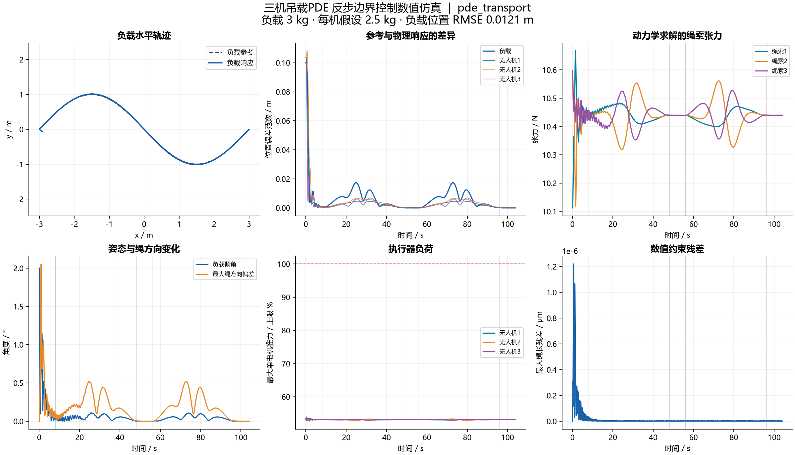
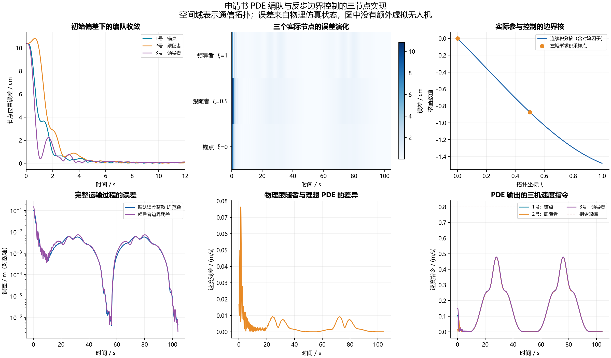

# 三机吊载 PDE 编队方法仿真报告

历史记录：本报告对应 PDE 单层阶段。当前串联方法及运行结果见 [合力预测与逆映射仿真报告](合力预测与逆映射仿真报告.md)，本报告数字不参与新版本统计。

已按申请书第 2.3(1) 节的 PDE 与反步边界控制公式，实现三机离散控制并完成 104 秒运输仿真。本次运行状态为 `completed`，仅评估该方法自身的物理响应，未开展算法性能对照。

方法采用三个实际拓扑节点、解析贝塞尔核及边界加权反馈；移动参考与有限带宽执行接口为本工程补全。它不是申请书全部研究模块的完整复现。详细方程、原文对应位置和补全依据见 [PDE 实现说明](../docs/pde_method.md)。

## 工况

- 三架四旋翼共同吊运 3 kg 刚性负载；每机假设质量 2.5 kg，最大总推力 65 N，绳长 1.8 m。
- 1号为锚点，2号为跟随者，3号为领导者，对应拓扑坐标 0、0.5、1。三机的物理布局为三角形。
- 从已经悬空且绳索绷紧的构型开始，整体位置初始偏移为 [0.08, -0.06, 0.0] m，负载绕 y 轴初始倾斜 2°。重建端点后初始绳长约束成立。
- 执行 8 秒保持、40 秒 S 形去程、8 秒保持、40 秒返程和 8 秒末段保持。本工况没有外加风力、故障或时延。
- PDE/速度环 50 Hz，姿态环 250 Hz，物理积分 500 Hz，日志 50 Hz。

## 运行结果

| 指标 | 本次结果 |
| --- | --- |
| 全程负载三维位置 RMSE，含初始恢复 | 12.071 mm |
| 初始保持之后的负载 RMSE，t≥8 s | 6.960 mm |
| 初始保持之后的负载最大位置误差 | 17.366 mm |
| 全程负载最大位置误差 | 100.000 mm（包含设定的初始偏差） |
| 全程最大负载倾角 | 2.0000°（包含初始倾斜） |
| 初始保持之后的最大负载倾角 | 0.1094° |
| 绳索张力范围 | 10.1124—10.6676 N |
| 最大单电机实际推力 | 8.7598 N，上限 16.25 N |
| 推力分配饱和更新比例 | 0.00% |
| 最大 PDE 速度指令 | 0.4788 m/s，上限 0.8 m/s |
| 最大 PDE 加速度指令 | 0.6706 m/s²，上限 1 m/s² |
| 速度 / 加速度限幅更新比例 | 0.00% / 0.00% |
| 三机最小质心间距 | 1.4389 m |
| 三机最小包围球净距 | 0.4789 m |
| 全系统最小场地包围球余量 | 0.4594 m |
| 最大绳长数值残差 | 1.220e-12 m |

阶段统计如下。RMSE 为负载三维误差范数的均方根，阶段之间不重复计算端点样本，末段包含最终样本。

| 阶段 | 时间 / s | 位置 RMSE / mm | 最大位置误差 / mm | 最大负载倾角 / ° |
| --- | --- | --- | --- | --- |
| 初始偏差恢复 | 0—8 | 36.238 | 100.000 | 2.0000 |
| S形去程 | 8—48 | 7.623 | 17.359 | 0.1094 |
| 远端保持 | 48—56 | 0.068 | 0.263 | 0.0023 |
| S形返程 | 56—96 | 7.628 | 17.366 | 0.1063 |
| 末段保持 | 96—104 | 0.067 | 0.263 | 0.0025 |



## PDE 是否实际参与控制

本次运行的边界权重为 `[-0.0, -0.43669635526158995]`。领导者的边界参考相对名义位置最大修正 47.287 mm，说明核加权反馈在本次运行中确实非零。跟随者速度使用当前三机误差的空间差分；仿真循环调用 `PDEController`，没有调用历史位置 PD 更新函数。

编队误差的离散 L² 范数由 0.103699 m 变化为终点的 4.568e-07 m；领导者边界残差终值为 2.092e-07 m。这些微小终值来自无噪声、未标定的理想数值模型，不能作为实机可达到精度。

内部跟随者的实际误差速度与 PDE 目标速度之差，均方根为 0.007287 m/s。非零残差反映有限带宽速度环和物理耦合，因此这里验证的是 PDE 离散控制器驱动物理对象的闭环响应，并未声称真实刚体轨迹严格满足连续 PDE。



## 数值检查

保存日志的 12 项一致性与约束检查：**全部通过**。检查包括完成时长、PDE 控制器标识、有限且对齐的记录、正张力、推力范围、采样间距、绳长残差、非零边界反馈、Volterra 边界关系，以及运行源码哈希的一致性。详见 [检查记录](pde_transport/run_checks.json)。

实现时还执行了 17 项单元检查，全部通过：原有 9 项物理/基础接口检查，以及 8 项新增 PDE 数学和连接检查。新增检查覆盖核方程和端点极限、对流变换、动态边界、邻居反馈、参考原点不变性、负载真值隔离和日志对齐。上述检查不属于算法性能对照实验。

张力的负值检查发生在每个 RK4 子步。表中状态峰值、最小距离及 PDE 残差来自 50 Hz 日志，不能视为连续时间极值的严格界限。

## 输出与复现

```powershell
.\.venv\Scripts\python.exe run_simulation.py --plots --animation
```

[三维动画](pde_transport/transport_simulation.gif) · [PDE速度指令](pde_transport/pde_control_commands.csv) · [原始状态](pde_transport/state_log.npz) · [数值指标](pde_transport/metrics.json) · [参数快照](pde_transport/config_snapshot.json)

名义参考 `reference_only_NOT_FLIGHT_READY.csv` 是随任务移动的理想三角形及其解析导数，不能误当成 PDE 实际反馈指令。实际速度和加速度命令在 `pde_control_commands.csv`，真实数值响应在状态日志中。

本版只涉及申请书 PDE 编队与反步边界方法；ESO、Tube MPC、故障/时延观测和学习避障未接入。参数尚未按实机标定，雷达、ROS/PX4、起吊落地和松绳重接触未建模，现有数据没有直接上机资格。三个实际节点也不足以证明连续极限、空间网格收敛或大规模可扩展性。
