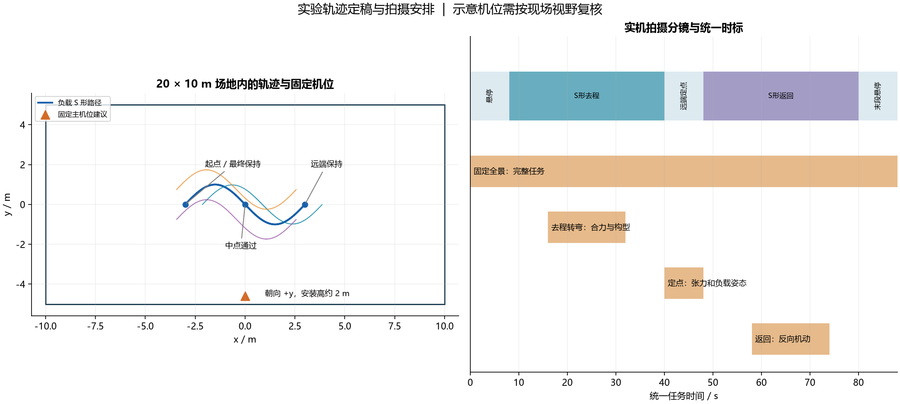
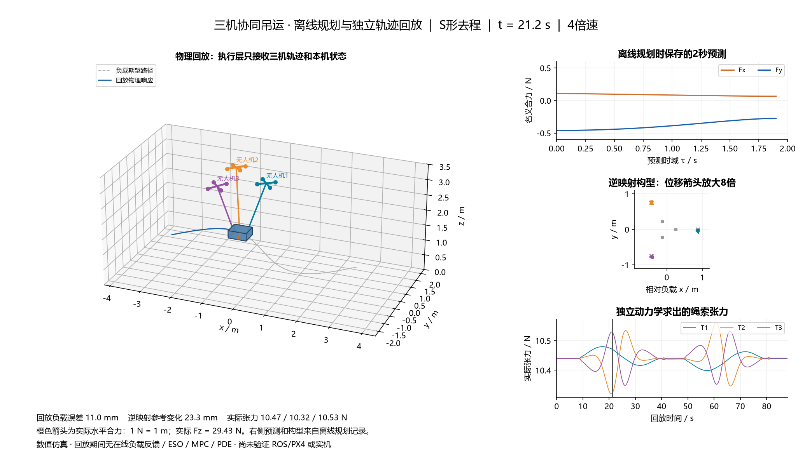

# 三机协同吊运：实验轨迹与拍摄方案

本版完成轨迹和仿真演示定稿，实机部分为后续实施设计。载重标称3 kg，可在重新规划和回放后减轻。三机采用统一局部坐标系，z向上，偏航保持0。控制与执行分为：离线生成含申请书方法的轨迹、在线由各机跟踪冻结轨迹。

## 时间与路径

| 时间/s | 动作 | 负载参考位置 | 需要呈现的内容 |
| --- | --- | --- | --- |
| 0—8 | 起点悬停 | (−3, 0, 0.875) m | 三机相对构型、三绳连接和编号 |
| 8—40 | 平滑S形去程 | x由−3到3 m，y为一次正弦 | 加速、转弯、减速驱动预测合力和逆映射变化 |
| 40—48 | 远端定点 | (3, 0, 0.875) m | 三机定点、负载姿态和张力保持 |
| 48—80 | 沿同一路径返回 | 原路反向 | 反向机动与三机同步 |
| 80—88 | 末段悬停 | (−3, 0, 0.875) m | 静止画面、末段误差和倾角 |

单程采用七次时间律 `s=35u^4−84u^5+70u^6−20u^7`，`u=(t−t_start)/32`；负载几何路径 `p_L,d=(−3+6s, sin(2πs), 0.875)`，返程将s反向。三机轨迹由合力逆映射给出，不能用固定三角队形简单平移替代导出文件。

每机50 Hz位置、速度、加速度，共 4401 个时间点。最大参考速度 0.589 m/s，最大参考加速度 0.151 m/s²。负载尺寸0.6×0.5×0.25 m，挂点径向半径0.25 m，挂点高于质心0.125 m，绳长1.8 m，名义绳角20°；名义无人机高度约2.691 m。不同硬件不能只换CSV文件名，应修改参数后重新验证。

## 说明链与证据对应

1. **预测合力**：仿真动画右上角显示当时保存的未来2秒名义Fx/Fy序列；这不是未来实际数据回填。
2. **逆向映射**：右中图显示三机相对负载的实际参考位置；灰叉为固定名义构型，彩点为逆映射结果。位移箭头明确放大8倍，机位坐标仍按真比例。最大参考变化 25.94 mm。
3. **可执行轨迹**：左侧三维场景由独立回放的物理状态生成，不把参考位置直接画成实际位置；橙色实际水平合力箭头按1 N=1 m显示，Fz以数字显示。
4. **运输响应**：显示回放求出的张力与负载位置误差。离线图中的预测/逆映射量和回放中的实际响应分开标明来源。

毫米至厘米量级的构型调整主要通过仿真曲线和标明比例的插图解释，实机录像以三机同步运输和轨迹复现为主要内容。

## 拍摄安排

- 主机位建议固定于场地侧边 `(0,−4.6,约2.0) m`，朝向+y，镜头覆盖三机、三根绳和完整运输路径。该位置是布置示意，现场需按镜头视角复核。
- 如有顶部固定安装条件，可在场地上方约4.7 m处设置俯视机位，中心对准原点，记录三机路径投影和相对构型。安装位置与飞行高度的实际余量另行检查。
- 一次任务连续录制全景；后期可用同一次录像裁切16—32秒去程转弯、40—48秒定点、58—74秒返回和80—88秒末段悬停。分镜清单见 [shot_list.csv](shot_list.csv)。
- 画面保留无人机1/2/3编号、统一时间和录像批次。仿真叠加层标注“离线规划”或“仿真响应”；实机轨迹叠加来自实测日志，并保留原始未叠加视频。
- 主机位保持定焦和连续视角便于对照空间运动；正式记录建议同时保存飞控、定位、指令时间戳和原始录像，后续依据共同时间事件对齐。

## 当前候选条件与交付范围

理想回放以及质量±10%单项检查已给出量化结果。拍摄候选设置采用位置每轴2 mm、速度0.005 m/s随机噪声，固定偏置各分量最大3 mm、定位延迟40 ms；组合检查还包含固定通信延迟、时钟偏移、质量偏差与0.3 N侧向脉冲。五个拍摄候选工况是否全部通过：**是**。

这些仅是已检验的数值样本，尚未测定雷达是否满足；更大的误差可能仍能完成运输，但静止画面倾角会超过本方案1°目标，详见 [可行性报告](轨迹回放可行性报告.md)。本版冻结悬空运输段，不含起吊/落地或ROS/PX4接入。

[MP4仿真演示](media/experiment_replay.mp4) · [GIF动画](media/experiment_replay.gif) · [三机轨迹CSV](trajectory/three_uav_trajectory_NOT_FLIGHT_READY.csv)

