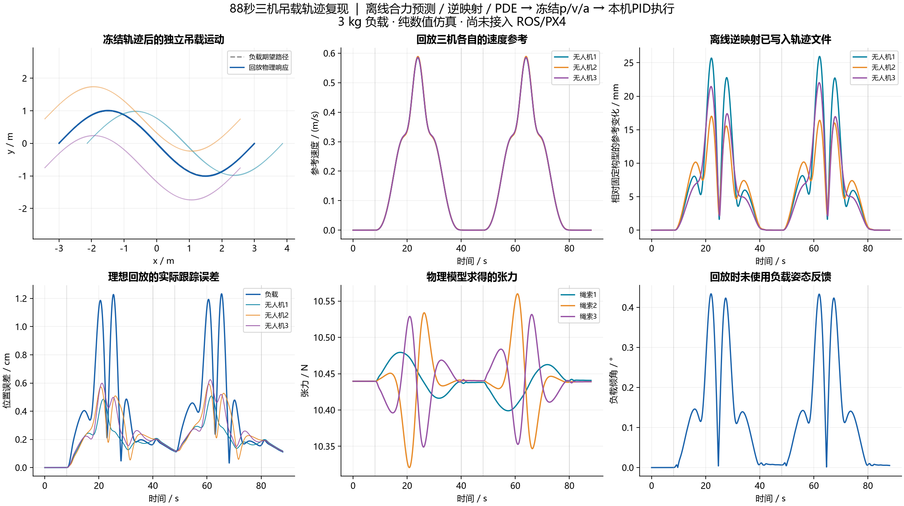
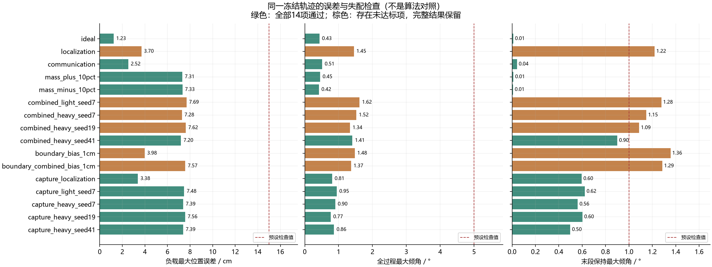

# 离线轨迹回放可行性报告

已完成离线轨迹回放模块和88秒展示轨迹定稿。16 个最终执行器工况均记录在本报告中；其中 10 个通过全部14项预设工程检查。低噪声拍摄候选工况全部通过：**是**。未通过的工况没有删去，也没有调宽1°末段倾角检查值。

理想回放：负载位置 RMSE **4.80 mm**，最大误差 **12.33 mm**，最大负载倾角 **0.434°**。

## 回放到底执行了什么

离线阶段继续使用申请书方法：ESO → 2秒平动合力预测 → 三绳向量力分配 → 编队逆映射 → PDE跟踪。将生成的三机各自位置、速度、加速度保存为独立数据包。所选轨迹来自无外加风扰的规划，不把一次特定风扰的反馈修正硬编码进正式拍摄轨迹。

回放从新的悬空平衡状态重新积分四刚体和三根绳索。数据包只有时间、三机p/v/a和零偏航，不包含绳力、负载状态、ESO输出或电机指令。执行器只取得各机自身位置/速度测量及姿态/角速度；PDE、MPC和ESO都不在回放期间在线运行。负载状态、真实张力及外加风力只进入评价日志。

执行层采用本机位置PID与几何姿态PD，**不是PX4的实际代码**。其力指令为

`F_i = m_U·sat_1[a_i,d + Kp(p_i,d−p_i,meas) + Kd(v_i,d−v_i,meas) + I_i] + (m_L,nom/3)·a_i,d + (m_U+m_L,nom/3)g·e_z + (m_L,nom/3)g tan20°·r_i`。

`Kp=(4,4,6)`，`Kd=(3.5,3.5,4)`；积分增益 `(0.3,0.3,0.8)`，积分加速度分量限于±0.6 m/s²，候选总加速度超过1 m/s²时暂停对应无人机的积分。标称负载始终为3 kg，质量偏差只改变物理负载及惯量。该静态分担补偿和本机积分是回放可行性的执行器假设，后续接PX4仍需校核是否等效实现。

数据包为50 Hz、每机 4401 个时刻，采用五次Hermite插值，p/v/a在记录区间内C²连续。区间外保持端点位置并置零速度/加速度；末端残余速度约 1.155e-06 m/s、加速度约 6.785e-06 m/s²，已在检查中确认可忽略。

## 最终展示轨迹

8秒起点悬停 → 32秒S形去程 → 8秒远端定点 → 32秒返回 → 8秒末段悬停。负载路径 x∈[−3,3] m、y∈[−1,1] m，负载质心高度0.875 m，名义无人机高度约2.691 m，绳长1.8 m；场地20×10×5 m。模型从已吊起状态开始。

三机参考速度峰值 0.5891 m/s，加速度峰值 0.1505 m/s²。Hermite区间端点/中点采样的jerk峰值为 0.1088 m/s³。相对负载固定构型的参考变化最大 **25.94 mm**；其中编队共同位移峰值 20.64 mm，扣除共同位移后的单机相对变形峰值 7.95 mm。这些量不等同于机间距离变化。



## 误差与失配设置

- `ideal`：理想本机状态测量和同步；`communication`：三机参考通信延迟20/40/60 ms，时钟偏移0/+10/−10 ms，相当于参考滞后20/30/70 ms。这是固定陈旧参考模型，不含丢包和网络抖动。
- `mass_plus/minus_10pct`：物理负载3.3/2.7 kg，控制器仍假设3 kg。
- `localization`、`combined_*`：位置每轴噪声标准差5 mm，速度每轴0.01 m/s，观测延迟40 ms，偏置向量各分量最大3 mm。
- `capture_*`：位置每轴噪声标准差2 mm，速度每轴0.005 m/s，观测延迟40 ms，偏置同上。组合工况同时加入质量偏差、通信/时钟误差，以及30—38秒峰值0.3 N的平滑侧向风力。重载组合记录种子7、19、41；轻载组合记录种子7。
- `boundary_*`：位置5 mm、速度0.01 m/s随机噪声，固定位置偏置各分量最大1 cm。

噪声是相关时间0.15 s的高斯AR(1)序列，从零噪声状态启动，参数为设定的渐近标准差；三机、三轴、位置与速度通道独立驱动。姿态和陀螺测量仍理想。固定偏置完整向量见 `replay_cases.json`。这些是假设工况，尚未确认实际雷达性能。少量随机种子不能给出成功概率或连续参数域保证。

## 全部结果

| 工况 | 实际负载/kg | 位置RMSE/mm | 最大位置误差/mm | 最大倾角/° | 末段最大倾角/° | 14项检查 |
| --- | --- | --- | --- | --- | --- | --- |
| ideal | 3.0 | 4.80 | 12.33 | 0.434 | 0.010 | 全部通过 |
| localization | 3.0 | 13.93 | 36.95 | 1.450 | 1.219 | 末段倾角>1° |
| communication | 3.0 | 10.64 | 25.24 | 0.514 | 0.042 | 全部通过 |
| mass_plus_10pct | 3.3 | 17.09 | 73.08 | 0.452 | 0.011 | 全部通过 |
| mass_minus_10pct | 2.7 | 17.00 | 73.27 | 0.417 | 0.008 | 全部通过 |
| combined_light_seed7 | 2.7 | 18.64 | 76.89 | 1.617 | 1.277 | 末段倾角>1° |
| combined_heavy_seed7 | 3.3 | 19.78 | 72.80 | 1.523 | 1.149 | 末段倾角>1° |
| combined_heavy_seed19 | 3.3 | 19.63 | 76.15 | 1.336 | 1.087 | 末段倾角>1° |
| combined_heavy_seed41 | 3.3 | 19.30 | 71.96 | 1.407 | 0.900 | 全部通过 |
| boundary_bias_1cm | 3.0 | 15.63 | 39.76 | 1.476 | 1.355 | 末段倾角>1° |
| boundary_combined_bias_1cm | 3.3 | 22.04 | 75.73 | 1.366 | 1.285 | 末段倾角>1° |
| capture_localization | 3.0 | 12.47 | 33.76 | 0.808 | 0.595 | 全部通过 |
| capture_light_seed7 | 2.7 | 17.63 | 74.78 | 0.945 | 0.622 | 全部通过 |
| capture_heavy_seed7 | 3.3 | 18.77 | 73.93 | 0.900 | 0.562 | 全部通过 |
| capture_heavy_seed19 | 3.3 | 18.70 | 75.62 | 0.766 | 0.602 | 全部通过 |
| capture_heavy_seed41 | 3.3 | 18.48 | 73.89 | 0.864 | 0.498 | 全部通过 |

全过程张力总范围 9.12—11.89 N，最小无人机包围球净距 0.474 m。每个工况的推力、限幅、误差和间距数值均保存在 `replay/<工况>/metrics.json`。



预设检查值：负载最大位置误差≤15 cm、无人机最大位置误差≤10 cm、负载倾角≤5°、绳方向偏差≤5°、张力4—18 N、机间包围球净距≥25 cm、场地包围球余量≥30 cm、单电机推力≤假设上限的80%、无电机饱和、无加速度限幅、末段位置RMSE≤5 cm、末段最大倾角≤1°、绳长残差≤10 μm，并完成全程。它们是本次选择的工程筛选值，不是实机认证指标。间距及极值来自50 Hz采样；负张力在所有RK4子步检查，出现即停止，未实现松绳模式。

较大测量误差下，完成运输并不自动满足末段静止画面的1°要求。拍摄候选设置的通过仅支持已运行的具体组合。若实测定位达不到该设置，应保留原始误差并重新运行相应工况，不能引用理想回放精度。

## 可复核数据与限制

36项单元测试全部通过，见[最终单元测试记录](unit_tests.txt)；另见[文件与运行数据审计](artifact_audit.json)。文件审计检查源日志、配置、冻结轨迹哈希、实际运行源码、载重失配隔离、全时段有限日志及判据重算；审计通过不表示未达标的工程工况通过。

初始执行器调试记录保留在 `debug_pd_initial/`，不混入上表最终执行器统计。研究方法本身没有引入其他算法做性能对照。

当前仅支持绷紧绳索的悬空运输，不含起吊落地、松绳重接触、下洗、全系统连续碰撞、ROS/PX4或实机传感器。飞机质量/推力、执行带宽、挂点和定位尚未实测。实机轨迹复现可支持“该轨迹能执行、能完成吊载演示”的结论；不能据此宣称申请书完整控制器已经在线实机验证。

## 文件与复现

[冻结三机轨迹CSV](trajectory/three_uav_trajectory_NOT_FLIGHT_READY.csv) · [轨迹清单](trajectory/manifest.json) · [各工况指标CSV](replay_case_metrics.csv) · [实验与拍摄方案](实验轨迹与拍摄方案.md) · [MP4演示](media/experiment_replay.mp4) · [GIF动画](media/experiment_replay.gif)

在项目根目录运行：

```powershell
.\.venv\Scripts\python.exe run_simulation.py --scenario nominal --leg-duration 32 --output results/experiment_v1/planning
.\.venv\Scripts\python.exe run_replay.py --suite --workers 3
.\.venv\Scripts\python.exe run_replay.py --cases configs/replay_capture_cases.json --append --workers 3
.\.venv\Scripts\python.exe tools/render_experiment.py --animation
.\.venv\Scripts\python.exe -m unittest discover -s tests -v 2>&1 | Tee-Object -FilePath results/experiment_v1/unit_tests.txt
.\.venv\Scripts\python.exe tools/report_experiment.py
```

广范围 `--suite` 中包含未达标工况，因此会以非零状态结束并保留全部结果；按顺序继续拍摄候选工况即可。`--append`保留既有结果并复用同一冻结轨迹，不允许重复工况名。更新源轨迹后应重新执行整套回放，不能混合不同轨迹的结果。
