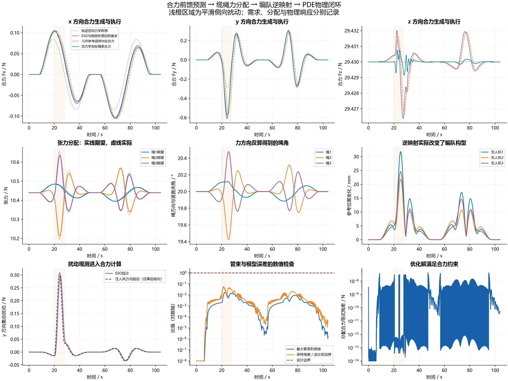
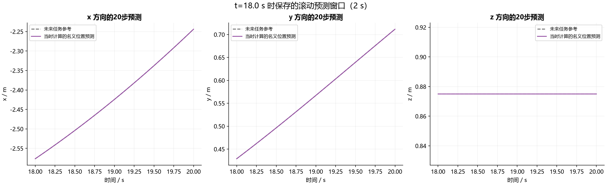
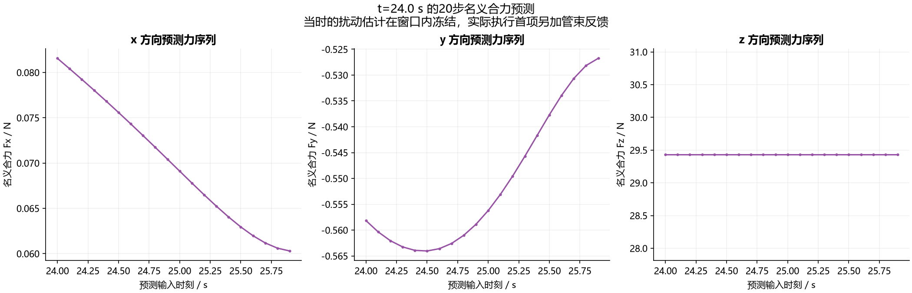
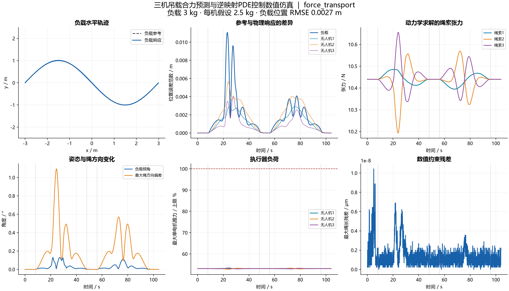

# 合力前馈预测与编队逆向映射仿真报告

本次已将申请书第 2.3(3) 节的“合力前馈预测—缆绳力分配—编队逆向映射”接入原有 PDE 控制与三机吊载物理模型。运行 104 秒，状态为 `completed`。本次只运行这一串联方法，不做算法性能对照。

**逆映射实际进入控制回路：**由优化绳力反算的三机参考构型，相对固定名义构型最大改变 **31.78 mm**；这些变化的位置及其解析速度、加速度参与 PDE 跟踪。完整方法和补全依据见 [方程与实现说明](../docs/force_prediction_mapping.md)。

## 实现链路

1. 由负载轨迹和未来 2 秒参考计算逆动力学前馈，动量 ESO 估计集总扰动。
2. 每 0.1 秒求解 20 步平动模型预测问题，惩罚输入变化；持续传播名义状态，用局部反馈与计算得到的误差管束收紧状态/输入约束。
3. 将合力需求与姿态力矩需求分配为三根三维绳力向量，满足六条力/力矩平衡等式与正拉力锥约束。
4. 当前分配力直接进入无人机力前馈；其平滑方向经过含负载挂点偏置的逆映射，生成 C² 连续构型参考。
5. PDE 控制跟随变化的构型，四旋翼与负载的真实数值运动仍由独立动力学积分求出。

因此，“求出了合力”“分配了绳力”“改变了构型”和“实际产生了该合力”是四类分别记录的量。报告中没有把优化等式的残差当成物理跟踪误差。

## 工况与参数

三架四旋翼共同吊运 3 kg 刚性负载，每机假设质量 2.5 kg、最大总推力 65 N，绳长 1.8 m，场地 20×10×5 m。从已经吊起的名义悬停开始，任务由 8 秒保持、40 秒去程、8 秒保持、40 秒返程和 8 秒末段保持组成。

在 t=20—28 s 向负载施加峰值 0.3 N 的平滑 y 向力。控制器没有取得这项扰动的真值；ESO 使用理想模拟负载速度与实际绳索合力测量。实机雷达/拉力传感器接口尚未实现。

外层力矩增益为 k_R=0.03、k_ω=0.008，几何参考滤波带宽 3 rad/s。该带宽配置配合当前 QP 力的及时前馈，避免让慢参考滤波延迟力矩阻尼。执行层为 50 Hz PDE/速度更新、250 Hz 姿态更新和 500 Hz 物理积分。

## 数值结果

| 指标 | 本次结果 |
| --- | --- |
| 全程负载三维位置 RMSE | 2.728 mm |
| 全程负载最大位置误差 | 11.072 mm |
| 最大负载倾角 | 0.1296° |
| 需求合力与物理实际合力 RMSE | 0.010914 N |
| 需求力矩与物理实际力矩 RMSE | 5.291e-05 N·m |
| ESO 集总扰动力估计 RMSE | 0.014787 N |
| 原始分配合力等式最大残差 | 4.136e-08 N |
| 原始分配力矩等式最大残差 | 1.281e-08 N·m |
| 构型逆映射的最大参考变化 | 31.776 mm |
| 逆映射得到的绳角范围 | 19.4224—20.4784° |
| 逆映射绳长最大残差 | 6.661e-16 m |
| 物理实际绳张力范围 | 10.1931—10.6548 N |
| 最大单电机实际推力 | 8.6820 N，上限 16.25 N |
| 电机推力饱和 / PDE速度限幅 / PDE加速度限幅比例 | 0.00% / 0.00% / 0.00% |
| 最小无人机质心间距 | 1.4871 m |
| 最小无人机包围球净距 | 0.5271 m |
| 最小场地包围球余量 | 0.4644 m |
| 最大管束利用率，界限为1 | 0.01615 |
| 最大采样残余加速度 / 所设扰动界 | 0.05669 |
| 三轴预测 QP 每次求解耗时中位数 / 峰值 | 0.1400 / 0.4844 ms |
| 分配 QP 求解耗时峰值 | 0.1524 ms |

求解耗时是本机本次 OSQP 报告的求解器运行时间，不包含整个 Python 控制循环、通信、感知或操作系统调度，不能据此宣称实机实时性。图和表中的极值均来自 50 Hz 日志。

| 阶段 | 时间 / s | 负载位置 RMSE / mm | 最大位置误差 / mm | 最大倾角 / ° |
| --- | --- | --- | --- | --- |
| 起点保持 | 0—8 | 0.000 | 0.003 | 0.0001 |
| S形去程，含侧向扰动 | 8—48 | 3.893 | 11.072 | 0.1296 |
| 远端保持 | 48—56 | 0.083 | 0.353 | 0.0025 |
| S形返程 | 56—96 | 2.048 | 4.084 | 0.1092 |
| 末段保持 | 96—104 | 0.083 | 0.353 | 0.0025 |



第一行分别显示逆动力学前馈、最终需求、几何参考滤波对应合力和物理实际合力。第二行显示优化张力、逆映射绳角及各机参考位置变化。第三行显示 ESO 估计、管束/扰动界检查及分配等式残差。浅橙时段为外加侧向扰动。



预测窗口来自仿真当时保存的 QP 预测状态，未用未来实际轨迹反向生成。



名义合力预测由保存的加速度序列和当时的 ESO 估计换算，窗口内冻结扰动估计；实际执行的合力等于首项再加质量缩放的管束反馈。该关系的最大数值残差为 7.105e-15 N。全部预测窗口见 [20步合力预测序列](force_mapping/force_prediction_horizon.csv)，不是只记录当前合力。



## 检查与解释范围

本次日志的 19 项检查 **全部通过**，详见 [检查记录](force_mapping/run_checks.json)。检查包括预测/分配求解、力平衡、力锥、参考导数、逆映射和实际绳长、非零构型变化、执行器限幅、采样净距、管束及设计扰动界。26 项实现单元检查均通过，其中新增了“力矩阻尼及时进入执行器而不等待几何参考运动”的检查。

Tube 设计只针对线性平动预测模型。误差管束及其收紧量由 Lyapunov 椭圆计算；本次轨迹在采样意义下满足设计界，不等于证明非线性吊载系统始终满足该界。本版没有终端不变约束、全六维非线性 Tube MPC 或递归可行性证明。完整模型参数也尚未实测辨识。

力锥和最小间距结论只适用于本次参数与轨迹。物理模型覆盖绳索绷紧的悬空运输，尚不含松绳重接触、起吊落地、雷达误差、ROS/PX4、下洗或全系统碰撞检测。所有数据是数值仿真结果。

## 文件与运行

```powershell
.\.venv\Scripts\python.exe run_simulation.py --plots --animation
```

默认配置 `configs/force_pde.json`，场景 `force_transport`，结果 `results/force_mapping`。

[三维动画](force_mapping/transport_simulation.gif) · [合力到构型数据链](force_mapping/force_prediction_mapping_chain.csv) · [逆映射参考轨迹](force_mapping/reference_only_NOT_FLIGHT_READY.csv) · [PDE指令](force_mapping/pde_control_commands.csv) · [原始日志](force_mapping/state_log.npz) · [配置快照](force_mapping/config_snapshot.json)

参考 CSV 中三机各自的位置、速度和加速度来自逆映射及解析导数；与 PDE 实际修正指令、物理响应分别保存。其用途是后续轨迹复现准备，尚未经过实机承载、坐标、同步和飞控校核。
